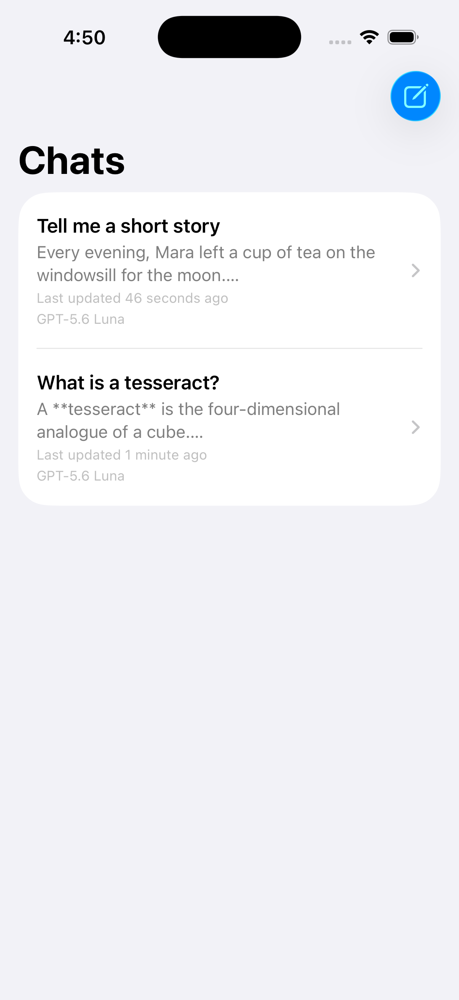
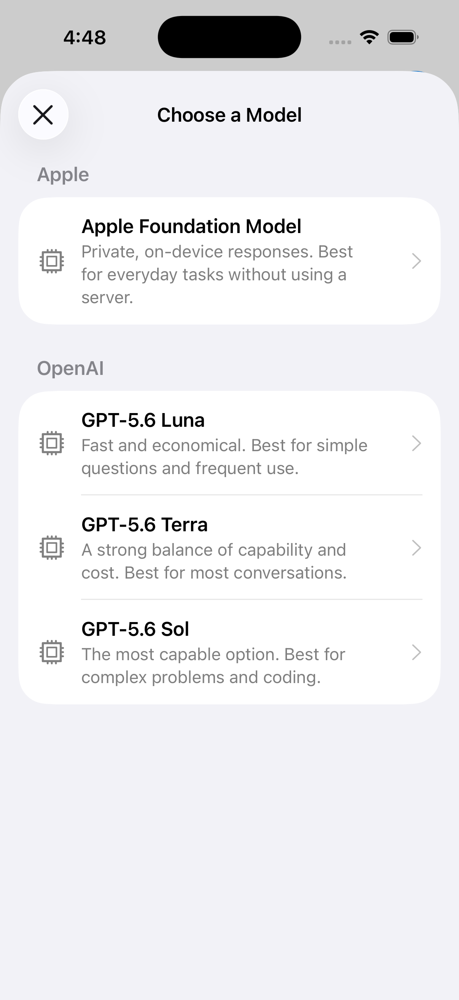

# ChatLLM

ChatLLM is a native iOS chat app for experimenting with Apple's on-device Foundation Models
and hosted models from OpenAI, Anthropic, and Google. It is a sandbox for SwiftUI,
local persistence, concurrency, and LLM integrations.

  
  
  

## Features

- Chat with Apple's on-device model on supported devices
- Choose from eight hosted models, grouped by provider
- Read model descriptions and availability information before starting a chat
- View assistant replies with Markdown formatting
- Save conversations locally and reopen them across app launches
- Continue older conversations with their original model
- Delete conversations from the chat list

Hosted conversations use OpenRouter through a Supabase Edge Function. Each conversation
stays with one model. The app is a personal learning project; it does not require a user account.

See [App Overview](https://github.com/samyanez94/ChatLLM/wiki/App-Overview#models)
for the current model lineup and limitations.

## Built With

- Swift and SwiftUI
- Observation and Swift concurrency
- SwiftData for local chat history
- Apple's Foundation Models framework
- URLSession for networking
- Supabase Edge Functions and OpenRouter for hosted inference
- Swift Markdown UI and Swift Collections
- Swift Testing and Deno tests

The project targets iOS 26.5 or later. This repository includes the iOS app and its backend.

## Running the Project

1. Clone the repository.
2. Copy `Configuration/ChatLLMConfiguration.plist.example` to
   `ChatLLM/Configuration/ChatLLMConfiguration.plist`.
3. Set `Endpoint` to your deployed chat function URL and `PublishableKey` to your
   Supabase project's publishable key.
4. Open `ChatLLM.xcodeproj` in a compatible Xcode version and select the `ChatLLM` scheme.
5. Choose an iPhone Simulator or configure signing for your device, then build and run.

The copied plist is Git-ignored. Hosted models need a configured backend with an OpenRouter
API key and available credits; follow the [backend guide](https://github.com/samyanez94/ChatLLM/wiki/Backend).
The OpenRouter key and Supabase secret credentials stay on the server.

You can also run without backend configuration. Hosted models will be unavailable; the
Apple model requires an Apple Intelligence-capable device with Apple Intelligence enabled
and the model ready.

## Documentation

- [App Overview](https://github.com/samyanez94/ChatLLM/wiki/App-Overview) — app behavior, models, and current limits.
- [Architecture](https://github.com/samyanez94/ChatLLM/wiki/Architecture) — state, persistence, and request flow.
- [Development](https://github.com/samyanez94/ChatLLM/wiki/Development) — run and test the iOS app.
- [Backend](https://github.com/samyanez94/ChatLLM/wiki/Backend) — configuration, API, tests, and deployment.

The versioned [Chat API contract](docs/chat-api.md) lives alongside the implementation.
